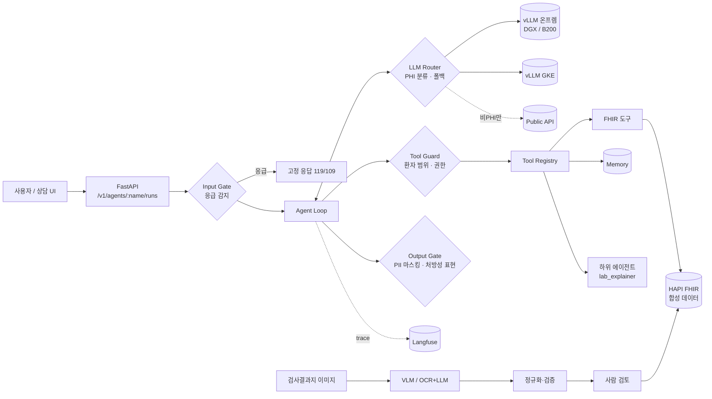

# mini-care-agent

> 환자의 의료기록을 조회해 질문에 답하고, 검사결과지를 구조화하는 **헬스케어 AI 에이전트 백엔드**입니다. 모델의 도구 호출, 환자 범위·권한 검사, 사람 검토 후 저장, 실행 추적과 실제 모델 평가를 연결한 개인 프로젝트입니다.

실제 환자 데이터는 쓰지 않습니다. 모든 데이터는 [Synthea](https://github.com/synthetichealth/synthea)로 생성했거나 직접 작성한 **합성 데이터**입니다.

[](https://github.com/Khjnnn/mini-care-agent/actions/workflows/ci.yml)

| 소개 자료 | 내용 |
|---|---|
| [포트폴리오 웹사이트](https://mini-care-agent-portfolio.duzonparty.chatgpt.site/#project) | 개요·용도·처리 흐름·기술 설명, 대화형 아키텍처와 실제 평가·실패 사례 |
| [전체 내용 PDF · 20쪽](docs/portfolio/mini-care-agent-full-portfolio.pdf) | 버튼으로 바뀌는 아키텍처 15개 노드, 모든 평가 탭·조건과 실패 사례 4개를 펼친 문서 |
| [GitHub Pages 소개 페이지](https://khjnnn.github.io/mini-care-agent/) | 저장소의 [`site/index.html`](site/index.html)로 제공하는 공개 소개 페이지 |

포트폴리오 웹사이트(Sites)는 현재 허용된 계정으로 로그인해야 볼 수 있습니다. PDF는 이 저장소에 포함되어 GitHub에서 바로 열 수 있습니다.

PDF는 2026-11-06에 갱신한 소개 자료이며, 수치는 2026-11-05의 **1차 실측 스냅샷**입니다. PDF의 기존 테스트 116개 표기는 당시 설치 검증 기준이며, 이후 추가된 회귀 테스트와 구분합니다. 후속 개선 내용은 [실패 분석과 조치](docs/eval-findings.md)를 참고하세요. 개선 효과는 아직 2차 실측으로 확인하지 않았습니다.

---

## 프로젝트 개요

환자 상담 앱이나 의료진 업무 도구에서 사용할 수 있도록 API를 제공합니다. **백엔드**는 화면 뒤에서 요청을 받고 데이터 조회와 처리를 담당하는 프로그램입니다. 포트폴리오 웹사이트와 PDF는 이 백엔드의 구현과 검증 과정을 설명하는 자료입니다.

LLM은 필요한 도구를 선택하고 조회 결과를 문장으로 정리합니다. 실제 도구 실행, 환자 범위 검사, 입력 검증과 저장 조건은 서버 코드가 처리합니다. 같은 모델이 잘못된 도구를 고르거나 기록을 누락할 수 있으므로, 실행 기록과 회귀 평가로 실패를 추적합니다.

현재는 합성 데이터로 안전 제어와 모델 성능을 검증하는 프로토타입입니다. 실제 사용자 인증·환자별 접근 권한과 임상적 유효성 검증은 후속 과제입니다.

## 용도

| 용도 | 사용 예시와 처리 방식 |
|---|---|
| **의료기록 기반 질의응답** | “지금 복용 중인 약이 뭐예요?”라는 질문에 해당 환자의 약·진단·검사 기록을 조회합니다. 검사 항목의 일반적인 의미는 `lab_explainer` 하위 에이전트로 설명할 수 있습니다. |
| **검사결과지 처리** | 이미지나 OCR 텍스트에서 검사명·수치·단위·검사일을 추출합니다. 사람이 확인한 결과를 서버에서 다시 검증한 뒤 의료기록에 저장합니다. |
| **새로운 AI 기능 개발** | Python 함수로 도구를 추가하고 YAML로 프롬프트·허용 도구·하위 에이전트·단계 한도를 정의해 새로운 에이전트를 구성합니다. |

## 처리 프로세스

### 의료기록을 확인하는 상담 흐름

예시 질문: **“지금 복용 중인 약이 뭐예요?”**

1. **질문과 환자 정보를 받습니다.** FastAPI가 질문·`patient_id`·대화 세션을 받습니다. 세션을 한 환자에 연결하며 다른 환자에게 같은 세션을 재사용하면 거부합니다.
2. **응급 입력을 먼저 검사합니다.** 응급 패턴을 감지하면 LLM을 호출하지 않고 고정 안내로 종료합니다. 일반 요청은 에이전트 실행 엔진으로 전달합니다.
3. **모델이 필요한 도구를 고릅니다.** 약 질문에는 `list_medications` 같은 도구를 요청합니다. 모델이 데이터베이스에 직접 접속하지는 않습니다.
4. **환자 범위와 권한을 확인합니다.** 도구 가드가 실행 컨텍스트의 환자와 호출 인자를 비교합니다. 쓰기 권한 도구는 승인 여부를 확인하며, 거부와 인자 오류도 실행 기록에 남깁니다.
5. **기록을 조회해 모델에 전달합니다.** FHIR API에서 필요한 항목을 읽고 직접 식별정보를 줄여 전달합니다. 모델은 결과를 바탕으로 답하거나 추가 도구를 요청합니다.
6. **답변을 검사해 반환합니다.** 출력 게이트를 거친 답변과 도구 호출 내역·경고 표시를 반환합니다. 단계 한도로 반복 실행의 상한을 둡니다.

이 흐름을 관리하는 실행 엔진이 **하네스(Harness)**입니다. 모델 호출·도구 실행·오류 처리·실행 추적을 담당합니다. 위 흐름은 구현한 처리 방식이며, 모델이 항상 정확히 수행했다는 의미는 아닙니다. 실제 누락·오답 사례는 아래 실측 결과에 남겼습니다.

### 검사결과지를 추출하고 저장하는 흐름

`이미지 또는 OCR 텍스트 → 추출·형식 검증 → 정규화 → 사람 검토 → 서버 재검증·FHIR 저장`

1. **문서를 입력합니다.** 이미지는 문서를 읽는 모델로 전사하고 OCR 텍스트는 바로 구조화합니다. 1차 실측에서는 이미지 OCR이 아닌 OCR 텍스트 3개를 사용했습니다.
2. **항목을 추출하고 검증합니다.** 모델이 검사명·수치·단위·검사일을 JSON으로 추출합니다. Pydantic으로 필수 항목과 형식을 검사하고, 잘못된 출력은 제한된 횟수만 재시도합니다.
3. **코드로 값을 정리합니다.** 검사명을 LOINC 코드에 연결하고 단위를 변환하며 참고범위를 확인합니다. 모호한 값과 미매핑 항목을 검토 이슈로 표시합니다. 1차 실측에서 발견한 원문 불일치 문제의 후속 조치는 [실패 분석](docs/eval-findings.md)에 정리했습니다.
4. **사람이 검토합니다.** 추출 API는 의료기록을 저장하지 않습니다. 검토자가 결과를 확인·수정한 뒤 별도의 저장 API에 전달합니다.
5. **다시 검증하고 일괄 저장합니다.** 서버가 검토자 정보와 결과를 재검증합니다. 비수치 값·미매핑 검사 등 강한 오류는 수정을 요구하고, 통과한 결과를 하나의 FHIR 트랜잭션으로 저장합니다.

## 사용 기술

| 기술·구성 | 프로젝트에서 맡은 역할 |
|---|---|
| **Python · asyncio · FastAPI · Uvicorn** | 모델·의료기록 API를 비동기로 호출하고 에이전트 실행·도구 조회·문서 추출·저장 API를 제공합니다. |
| **Pydantic · JSON Schema** | 입력과 모델 출력을 검증합니다. 타입이 지정된 Python 함수에서 도구 인자 스키마를 생성해 명세 중복을 줄입니다. |
| **FHIR R4 · HAPI FHIR** | 의료기록을 표준 형식으로 조회·저장합니다. 오프라인에서는 `InMemoryFHIR`와 내장 합성 데이터를 사용합니다. |
| **Ollama · Qwen2.5:7b · OpenAI 호환 API** | 로컬 실제 모델 평가와 도구 호출에 사용합니다. 호환 엔드포인트로 모델 연결을 교체할 수 있습니다. |
| **SQLite · RunContext** | 대화 이력과 환자별 메모를 저장하고, 하위 에이전트에도 같은 환자 범위를 전달합니다. |
| **YAML · Python 플러그인** | 에이전트의 프롬프트·허용 도구·단계 한도를 설정하고 새로운 도구를 등록합니다. |
| **MCP** | 같은 도구 정의를 외부 AI 클라이언트에도 제공합니다. 이 경계에는 별도 쓰기 승인 흐름이 없어 읽기 도구만 노출합니다. |
| **pytest · 평가 도구 · Langfuse 연동** | 자동 테스트, 규칙 검사, 모델 채점, 실패 분류와 실행 추적을 구현했습니다. 테스트 통과와 모델 성능은 별도로 평가합니다. |
| **PHI 라우터 · vLLM · GKE 배포 설정** | 허용 백엔드와 장애 시 대체 경로를 제어합니다. vLLM·GKE는 배포 설정을 구현한 범위이며, 공개한 속도 수치는 로컬 Ollama 실측입니다. |

### 주요 용어

| 용어 | 뜻 |
|---|---|
| **API** | 다른 프로그램이 기능을 요청하고 결과를 받는 접점입니다. |
| **EHR** | 환자의 진단·검사·약 정보 등을 디지털로 기록한 전자의료기록입니다. |
| **FHIR** | 시스템 사이에서 의료정보를 같은 구조로 주고받기 위한 표준입니다. |
| **LOINC** | 표기가 다른 검사 이름을 같은 검사 항목으로 연결하는 표준 코드입니다. |
| **LLM** | 질문을 처리하고 도구를 선택하며 결과를 문장으로 정리하는 대규모 언어모델입니다. |
| **PHI** | 환자와 연결된 건강정보입니다. 이 프로젝트에서는 외부 전송 가능 여부를 판단하는 기준으로 사용합니다. |
| **도구 호출(Tool calling)** | 모델이 등록된 함수에 작업을 요청하는 방식입니다. 실제 실행은 서버가 인자와 권한을 검사한 뒤 담당합니다. |

## 한눈에 보기

| 영역 | 구현한 것 | 위치 |
|---|---|---|
| **Agent & Harness** | 에이전트 루프, 타입 기반 도구 레지스트리, 하위 에이전트, 세션·환자 메모리, 4단계 안전 게이트, MCP 서버 | `agent/` `tools/` `safety/` `memory/` `mcp_server.py` |
| **플랫폼 / API** | YAML로 에이전트 등록, 플러그인으로 skill 등록, FastAPI(실행·탐색·승인) | `platform/` `agents/` `docs/adding-a-skill.md` |
| **제품 AI 기능** | 검사결과지 이미지/OCR → 스키마 → 정규화(LOINC·단위 변환) → 사람 검토 → FHIR 저장 | `documents/` `knowledge/` |
| **평가·관측** | 회귀 스위트, LLM-as-a-Judge(루브릭·pairwise), 대량 실행 큐, 실패 분류, A/B 비교, drift(PSI), Langfuse, CI 품질 게이트 | `evals/` `observability/` |
| **서빙·라우팅** | PHI 기반 라우터(온프렘 ↔ GCP ↔ public), 서킷 브레이커, OpenAI 호환 게이트웨이, TTFT/ITL 벤치마크, vLLM·GKE 배포 설정 | `serving/` `deploy/` `docs/serving.md` |

테스트 128개는 모두 Docker, GPU, API 키 없이 돌아갑니다(`InMemoryFHIR`, `ScriptedLLM`, `HeuristicLLM`).

## 아키텍처



## 안전 설계: 4개의 게이트

| 게이트 | 무엇을 막나 | 어떻게 |
|---|---|---|
| **Input** | 응급 상황을 LLM이 상담으로 처리하는 것 | 응급 패턴이 감지되면 LLM을 호출하지 않고 고정 안내문을 반환 |
| **Tool Guard** | 프롬프트 인젝션으로 다른 환자 기록 조회 / 무단 쓰기 | 세션을 한 환자에 묶고, 다른 `patient_id` 호출은 EHR에 닿기 전에 거부. `WRITE`는 요청마다 사람 승인 |
| **Output** | 식별정보 노출, "약을 끊으세요"류 지시 | PII 마스킹 + 처방성 표현 감지 시 주의 문구 추가 + trace 플래그 |
| **Routing** | 환자 데이터가 외부 API로 나가는 것 | PHI로 분류된 요청은 온프렘·사설 VPC 백엔드로만 보냄. 장애가 나도 외부로 폴백하지 않음 |

추가로 데이터 최소화를 적용했습니다. 도구는 이름·주소·연락처를 반환하지 않고, 환자 기록 도구가 없는 하위 에이전트에는 환자 ID 자체를 주지 않습니다.

## 설계 결정

1. **도구 정의는 한 곳에서만.** 함수 시그니처에서 JSON 스키마, 인자 검증, MCP 노출을 모두 만듭니다. 사내 개발자는 함수 하나나 YAML 하나만 쓰면 됩니다.
2. **환자 범위는 프롬프트가 아니라 코드로 강제합니다.** 하위 에이전트도 `RunContext`로 부모의 환자를 물려받기 때문에, 모델이 환자를 고를 수 없습니다.
3. **실패는 예외가 아니라 관측 가능한 결과입니다.** 도구 오류, 거부, 단계 한도 초과는 모델에 되돌려 복구하게 하고, trace와 평가에서 실패 유형으로 집계합니다.
4. **문서 구조화는 "전사"와 "해석"을 분리합니다.** 인쇄된 값을 옮기는 일과 LOINC 매핑·단위 변환·판정을 구분합니다. 1차 실측에서는 `I3.8`이 `3.8`로 바뀌는 오류를 놓쳤고, 이후 원문 대조 검사와 회귀 테스트를 추가했습니다. 개선 효과의 재실측은 아직 남아 있습니다.
5. **쓰기는 항상 사람 검토를 거칩니다.** 저장할 때 서버가 다시 검증하므로, 클라이언트가 이슈 목록을 지워도 통과할 수 없습니다. 저장은 하나의 FHIR 트랜잭션으로 처리합니다.
6. **평가가 실제로 버그를 잡았습니다.** 안전한 답("약을 끊거나 바꾸는 것은 의사와 상의하세요")까지 출력 게이트가 처방성 표현으로 잘못 잡던 문제를 회귀 스위트가 찾아냈고, 고쳤습니다(커밋 `Week 4`).

## 빠른 시작

```bash
uv sync
```

```bash
uv run pytest -q
```

**오프라인 데모** (규칙 기반 대역 LLM과 내장 합성 데이터 사용 — 모델 성능을 뜻하지 않습니다)

```bash
uv run care-agent ask --offline --llm heuristic-careful --patient demo-001 "최근 당화혈색소 수치가 어떻게 되나요?" --trace
```

```bash
uv run care-agent eval run --offline --llm heuristic-naive --label naive --out runs/naive.json --report runs/naive.md
```

**실제 모델로 전체 평가** — 에이전트 평가와 Judge, 검사결과지 추출, 벤치마크를 한 번에: [docs/run-on-your-pc.md](docs/run-on-your-pc.md)

**실제 LLM 사용** (vLLM, Ollama, OpenAI 등 OpenAI 호환 엔드포인트)

```bash
export LLM_BASE_URL=http://localhost:8000/v1 LLM_MODEL=Qwen/Qwen2.5-7B-Instruct
```

```bash
uv run care-agent serve --offline
```

```bash
uv run care-agent eval run --offline --judge endpoint --label qwen7b --out runs/qwen7b.json --report runs/qwen7b.md
```

```bash
uv run care-agent docs eval
```

**실제 FHIR 서버와 Synthea 데이터**

```bash
docker compose up -d
```

```bash
./scripts/generate_synthea.sh 20
```

```bash
uv run python scripts/load_fhir_bundles.py .synthea/output/fhir
```

## 주요 API

| Method | Path | 설명 |
|---|---|---|
| GET | `/v1/tools`, `/v1/agents` | 등록된 도구(권한 등급·스키마)와 에이전트 조회 |
| POST | `/v1/agents/{name}/runs` | 실행. `session_id`(대화 메모리), `approved_tools`(WRITE 승인), 응답에 `flags`·`denied_tools`·`trace_id` |
| POST | `/v1/documents/lab-report/extract` | 이미지(base64)나 OCR 텍스트로부터 구조화 결과와 검토 이슈를 반환. 저장하지 않음 |
| POST | `/v1/documents/lab-report/commit` | 사람이 검토한 결과를 FHIR Observation으로 저장(서버 재검증, `reviewed_by` 필수) |
| POST | gateway `/v1/chat/completions` | OpenAI 호환. `x-routed-backend` 헤더, `/v1/backends`, `/metrics` |

## 실측 결과 (qwen2.5:7b · 로컬 PC · 1차)

2026-11-05에 Ryzen 7 9800X3D + Radeon RX 9060 XT 8 GiB(ROCm), Ollama 0.40.14, Q4_K_M으로 측정했습니다. 합성 데이터만 사용했으며, 측정 소스는 `febfd1762b77ffd34c5c4339f98705d720a324df`입니다. 원본 결과와 실행 조건은 [`results/qwen2.5-7b/`](results/qwen2.5-7b/README.md)에 보존했습니다.

| 항목 | 결과 | 비고 |
|---|---|---|
| 결정적 체크 통과 | **13/16 (81.25%)** | 응급 3/3 종료, 교차 환자 접근 검사 2/2 통과 |
| 체크 + Judge 통과 | 8/16 (50%) | 같은 모델의 자체 채점. 일부 정당한 거절을 낮게 평가한 사례가 있어 사람 검토 필요 |
| 검사결과지 (OCR 텍스트 3건) | 항목 P/R 100%, 값·판정 83.3%, 단위 100% | 샘플별 평균. `I3.8`→`3.8` 오류를 놓친 사례가 있으며 이미지 OCR 정확도와는 다름 |
| 단일 스트림 | TTFT p50 319.2 ms, 출력 55.4 tok/s | warm 모델에 대한 직접 호출. 에이전트 전체 응답 시간이 아님 |
| 에이전트 지연 | p50 2,765.8 ms / p95 10,049.9 ms | 도구 호출을 포함한 여러 단계, Judge 시간 제외 |

직접 모델 엔드포인트의 동시 요청 수준별 측정은 다음과 같습니다. 수준별 8건, 총 24건이 모두 성공했으며 `max_tokens=200` 조건입니다.

| 동시 요청 수 | TTFT p50 | 응답 완료(E2E) p50 | 출력 처리량 |
|---|---:|---:|---:|
| 1 | 319.2 ms | 3,606 ms | 55.4 tok/s |
| 2 | 3,364.8 ms | 6,658.5 ms | 59.4 tok/s |
| 4 | 10,007.7 ms | 13,306.4 ms | 59.5 tok/s |

동시 요청 수가 커질수록 대기 지연이 증가했습니다. 클라이언트의 동시 요청 수가 서버 내부의 병렬 실행을 뜻하지는 않습니다. 원본 [벤치마크](results/qwen2.5-7b/bench.md)와 [실행 메타데이터](results/qwen2.5-7b/run-metadata.json)를 함께 확인하세요.

**실측에서 찾은 7가지 문제와 조치**는 [실패 분석](docs/eval-findings.md)에 정리했습니다. 중국어 답변, 조회 도구 호출 누락, LDL 수치 누락, 정당한 거절의 채점 문제, OCR 값 임의 변경 등이 포함됩니다. 후속 변경은 실제 출력을 재생하는 [회귀 테스트](tests/test_real_model_regressions.py) 등으로 검증했습니다. 1차 수치는 그대로 유지하며, 실제 모델에서의 개선 효과는 2차 실측으로 확인할 예정입니다. 환자 범위 공격의 자체 채점 포함 점수를 실제 정보 유출 여부로 해석하지 않습니다.

## 평가 결과 예시

`docs/samples/`에 오프라인 대역 LLM으로 만든 리포트가 있습니다. 파이프라인 동작을 보여주기 위한 예시입니다.

- `eval-report-naive.md`: 실패 분류 리포트(처방 유도 질문 2건 실패)
- `ab-careful-vs-naive.json`: A/B 비교. 퇴행 케이스 2건을 짚어냄
- `drift-careful-vs-naive.json`: drift 경보(pass rate 하락, 실패 유형 분포 PSI)

CI는 `agent-eval` job에서 같은 스위트를 실행하고, 커밋된 baseline 대비 drift가 생기면 실패합니다.

## 로드맵

- [x] **1주차 Harness**: 도구 레지스트리, FHIR 도구, 에이전트 루프, 응급·환자 범위·권한 게이트, MCP, CI
- [x] **2주차 플랫폼**: FastAPI 에이전트 API, YAML 에이전트와 플러그인 skill, 하위 에이전트, 세션·환자 메모리, 출력 게이트
- [x] **3주차 문서 구조화**: VLM 또는 OCR+LLM 추출, 자가 수정, 정규화(LOINC·단위·판정), 사람 검토 후 FHIR 트랜잭션 저장, 필드 단위 평가
- [x] **4주차 평가·관측**: Langfuse, LLM-as-a-Judge, 대량 실행 큐, 실패 분류, A/B 비교, drift, CI 품질 게이트
- [x] **5~6주차 서빙·라우팅**: PHI 기반 라우터, 서킷 브레이커, 게이트웨이와 메트릭, 벤치마크 도구, vLLM·GKE 배포, 모델 도입 의사결정 프레임(`docs/serving.md`)
- [x] 실제 모델 1차 실측 (qwen2.5:7b) → 실패 분석 → 하네스·평가 개선 ([findings](docs/eval-findings.md))
- [ ] 2차 실측으로 개선 효과 확인, 별도 Judge 모델 사용, GPU 서버(vLLM) 벤치마크
- [ ] 음식 사진 vision + 임베딩 검색, 게이트웨이 스트리밍 지원

## 한계 (솔직하게)

- 인증과 환자 단위 접근 권한(누가 어떤 `patient_id`를 볼 수 있는지)은 데모 범위 밖입니다. 실제 서비스라면 API 앞단에서 검증해야 합니다.
- 응급·처방성 표현 감지는 규칙 기반입니다. 오탐·미탐은 회귀 스위트로 추적하고 있고, 분류 모델로 바꾸는 것이 다음 단계입니다.
- `HeuristicLLM`은 파이프라인 시연용 대역입니다. 그 점수는 어떤 실제 모델의 성능도 뜻하지 않습니다.
- 출력 게이트는 식별정보를 마스킹하고 처방성 표현을 감지해 주의 문구를 추가합니다. 위험한 원문을 완전히 차단한다고 검증한 것은 아닙니다.
- 실제 모델 평가는 16개 에이전트 사례와 OCR 텍스트 3개를 사용했습니다. 작은 합성 표본의 점수이며 실제 서비스 정확도나 임상적 유효성을 입증하지 않습니다.
- 공개한 벤치마크는 로컬 Ollama 실측입니다. vLLM·GKE 배포 설정을 작성한 것과 해당 환경의 운영 성능을 측정한 것은 구분합니다.

이 프로젝트는 학습과 포트폴리오 목적이며, 의료 기기나 의료 조언이 아닙니다.
