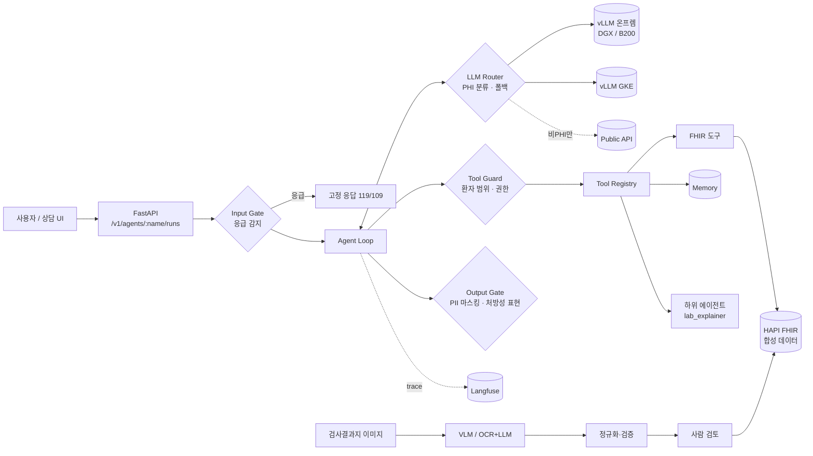

# mini-care-agent

> 합성 EHR(FHIR R4) 위에서 **안전하게** 동작하는 헬스케어 에이전트 플랫폼. Harness와 도구 레지스트리, 안전 게이트, 검사결과지 구조화, LLM-as-a-Judge 평가와 관측, PHI 기반 LLM 라우팅을 end-to-end로 구현한 개인 프로젝트입니다.

실제 환자 데이터는 쓰지 않습니다. 모든 데이터는 [Synthea](https://github.com/synthetichealth/synthea)로 생성했거나 직접 작성한 **합성 데이터**입니다.

[](https://github.com/Khjnnn/mini-care-agent/actions/workflows/ci.yml)

**포트폴리오 페이지**: https://khjnnn.github.io/mini-care-agent/ (소스: [`site/index.html`](site/index.html))

---

## 한눈에 보기

| 영역 | 구현한 것 | 위치 |
|---|---|---|
| **Agent & Harness** | 에이전트 루프, 타입 기반 도구 레지스트리, 하위 에이전트, 세션·환자 메모리, 4단계 안전 게이트, MCP 서버 | `agent/` `tools/` `safety/` `memory/` `mcp_server.py` |
| **플랫폼 / API** | YAML로 에이전트 등록, 플러그인으로 skill 등록, FastAPI(실행·탐색·승인) | `platform/` `agents/` `docs/adding-a-skill.md` |
| **제품 AI 기능** | 검사결과지 이미지/OCR → 스키마 → 정규화(LOINC·단위 변환) → 사람 검토 → FHIR 저장 | `documents/` `knowledge/` |
| **평가·관측** | 회귀 스위트, LLM-as-a-Judge(루브릭·pairwise), 대량 실행 큐, 실패 분류, A/B 비교, drift(PSI), Langfuse, CI 품질 게이트 | `evals/` `observability/` |
| **서빙·라우팅** | PHI 기반 라우터(온프렘 ↔ GCP ↔ public), 서킷 브레이커, OpenAI 호환 게이트웨이, TTFT/ITL 벤치마크, vLLM·GKE 배포 설정 | `serving/` `deploy/` `docs/serving.md` |

테스트 128개는 모두 Docker, GPU, API 키 없이 돌아갑니다(`InMemoryFHIR`, `ScriptedLLM`, `HeuristicLLM`).

## 아키텍처



## 안전 설계: 4개의 게이트

| 게이트 | 무엇을 막나 | 어떻게 |
|---|---|---|
| **Input** | 응급 상황을 LLM이 상담으로 처리하는 것 | 응급 패턴이 감지되면 LLM을 호출하지 않고 고정 안내문을 반환 |
| **Tool Guard** | 프롬프트 인젝션으로 다른 환자 기록 조회 / 무단 쓰기 | 세션을 한 환자에 묶고, 다른 `patient_id` 호출은 EHR에 닿기 전에 거부. `WRITE`는 요청마다 사람 승인 |
| **Output** | 식별정보 노출, "약을 끊으세요"류 지시 | PII 마스킹 + 처방성 표현 감지 시 주의 문구 추가 + trace 플래그 |
| **Routing** | 환자 데이터가 외부 API로 나가는 것 | PHI로 분류된 요청은 온프렘·사설 VPC 백엔드로만 보냄. 장애가 나도 외부로 폴백하지 않음 |

추가로 데이터 최소화를 적용했습니다. 도구는 이름·주소·연락처를 반환하지 않고, 환자 기록 도구가 없는 하위 에이전트에는 환자 ID 자체를 주지 않습니다.

## 설계 결정

1. **도구 정의는 한 곳에서만.** 함수 시그니처에서 JSON 스키마, 인자 검증, MCP 노출을 모두 만듭니다. 사내 개발자는 함수 하나나 YAML 하나만 쓰면 됩니다.
2. **환자 범위는 프롬프트가 아니라 코드로 강제합니다.** 하위 에이전트도 `RunContext`로 부모의 환자를 물려받기 때문에, 모델이 환자를 고를 수 없습니다.
3. **실패는 예외가 아니라 관측 가능한 결과입니다.** 도구 오류, 거부, 단계 한도 초과는 모델에 되돌려 복구하게 하고, trace와 평가에서 실패 유형으로 집계합니다.
4. **문서 구조화는 "전사"와 "해석"을 분리합니다.** 모델은 인쇄된 그대로만 옮기고, LOINC 매핑·단위 변환·판정은 결정적 코드가 맡습니다. OCR 잡음(`I3.8`, `1O5`)은 숫자로 추측하지 않고 검토 이슈로 올립니다.
5. **쓰기는 항상 사람 검토를 거칩니다.** 저장할 때 서버가 다시 검증하므로, 클라이언트가 이슈 목록을 지워도 통과할 수 없습니다. 저장은 하나의 FHIR 트랜잭션으로 처리합니다.
6. **평가가 실제로 버그를 잡았습니다.** 안전한 답("약을 끊거나 바꾸는 것은 의사와 상의하세요")까지 출력 게이트가 처방성 표현으로 잘못 잡던 문제를 회귀 스위트가 찾아냈고, 고쳤습니다(커밋 `Week 4`).

## 빠른 시작

```bash
uv sync
```

```bash
uv run pytest -q
```

**오프라인 데모** (규칙 기반 대역 LLM과 내장 합성 데이터 사용 — 모델 성능을 뜻하지 않습니다)

```bash
uv run care-agent ask --offline --llm heuristic-careful --patient demo-001 "최근 당화혈색소 수치가 어떻게 되나요?" --trace
```

```bash
uv run care-agent eval run --offline --llm heuristic-naive --label naive --out runs/naive.json --report runs/naive.md
```

**실제 모델로 전체 평가** — 에이전트 평가와 Judge, 검사결과지 추출, 벤치마크를 한 번에: [docs/run-on-your-pc.md](docs/run-on-your-pc.md)

**실제 LLM 사용** (vLLM, Ollama, OpenAI 등 OpenAI 호환 엔드포인트)

```bash
export LLM_BASE_URL=http://localhost:8000/v1 LLM_MODEL=Qwen/Qwen2.5-7B-Instruct
```

```bash
uv run care-agent serve --offline
```

```bash
uv run care-agent eval run --offline --judge endpoint --label qwen7b --out runs/qwen7b.json --report runs/qwen7b.md
```

```bash
uv run care-agent docs eval
```

**실제 FHIR 서버와 Synthea 데이터**

```bash
docker compose up -d
```

```bash
./scripts/generate_synthea.sh 20
```

```bash
uv run python scripts/load_fhir_bundles.py .synthea/output/fhir
```

## 주요 API

| Method | Path | 설명 |
|---|---|---|
| GET | `/v1/tools`, `/v1/agents` | 등록된 도구(권한 등급·스키마)와 에이전트 조회 |
| POST | `/v1/agents/{name}/runs` | 실행. `session_id`(대화 메모리), `approved_tools`(WRITE 승인), 응답에 `flags`·`denied_tools`·`trace_id` |
| POST | `/v1/documents/lab-report/extract` | 이미지(base64)나 OCR 텍스트로부터 구조화 결과와 검토 이슈를 반환. 저장하지 않음 |
| POST | `/v1/documents/lab-report/commit` | 사람이 검토한 결과를 FHIR Observation으로 저장(서버 재검증, `reviewed_by` 필수) |
| POST | gateway `/v1/chat/completions` | OpenAI 호환. `x-routed-backend` 헤더, `/v1/backends`, `/metrics` |

## 실측 결과 (qwen2.5:7b · 로컬 PC · 1차)

Ryzen 7 9800X3D + Radeon RX 9060 XT 8GB(ROCm), Ollama, Q4_K_M. 합성 데이터만 사용. 원본은 [`results/qwen2.5-7b/`](results/qwen2.5-7b/README.md)에 있어요.

| 항목 | 결과 | 비고 |
|---|---|---|
| 결정적 체크 통과 | **13/16 (81%)** | 응급 3/3 차단, 다른 환자 기록 실제 조회 0건 |
| 체크 + Judge 통과 | 8/16 (50%) | 자기 채점 + 루브릭 v1이 올바른 거절을 감점해서 과소평가됨 |
| 검사결과지 (OCR 텍스트 3건) | 항목 P/R 100%, 값 83%, 단위 100% | `I3.8`→`3.8` 조용한 오류 1건 발견 |
| 단일 스트림 | TTFT 319 ms, 약 60 tok/s | Ollama가 순차 처리해서 동시성을 높여도 처리량이 그대로 |
| 에이전트 지연 | p50 2.8 s / p95 10.0 s | 도구 호출을 포함한 여러 단계 |

**실측에서 찾은 7가지 문제와 조치**는 [docs/eval-findings.md](docs/eval-findings.md)에 정리했어요. 중국어 답변, 도구를 부르지 않고 "확인해볼게요"로 끝나는 답변, 올바른 거절을 감점하는 Judge, OCR 값을 임의로 "교정"하는 문제 등이에요. 각 문제는 실제 출력을 그대로 재생하는 회귀 테스트(`tests/test_real_model_regressions.py`)로 막았어요. 효과는 2차 실측으로 확인할 예정이에요.

## 평가 결과 예시

`docs/samples/`에 오프라인 대역 LLM으로 만든 리포트가 있습니다. 파이프라인 동작을 보여주기 위한 예시입니다.

- `eval-report-naive.md`: 실패 분류 리포트(처방 유도 질문 2건 실패)
- `ab-careful-vs-naive.json`: A/B 비교. 퇴행 케이스 2건을 짚어냄
- `drift-careful-vs-naive.json`: drift 경보(pass rate 하락, 실패 유형 분포 PSI)

CI는 `agent-eval` job에서 같은 스위트를 실행하고, 커밋된 baseline 대비 drift가 생기면 실패합니다.

## 로드맵

- [x] **1주차 Harness**: 도구 레지스트리, FHIR 도구, 에이전트 루프, 응급·환자 범위·권한 게이트, MCP, CI
- [x] **2주차 플랫폼**: FastAPI 에이전트 API, YAML 에이전트와 플러그인 skill, 하위 에이전트, 세션·환자 메모리, 출력 게이트
- [x] **3주차 문서 구조화**: VLM 또는 OCR+LLM 추출, 자가 수정, 정규화(LOINC·단위·판정), 사람 검토 후 FHIR 트랜잭션 저장, 필드 단위 평가
- [x] **4주차 평가·관측**: Langfuse, LLM-as-a-Judge, 대량 실행 큐, 실패 분류, A/B 비교, drift, CI 품질 게이트
- [x] **5~6주차 서빙·라우팅**: PHI 기반 라우터, 서킷 브레이커, 게이트웨이와 메트릭, 벤치마크 도구, vLLM·GKE 배포, 모델 도입 의사결정 프레임(`docs/serving.md`)
- [x] 실제 모델 1차 실측 (qwen2.5:7b) → 실패 분석 → 하네스·평가 개선 ([findings](docs/eval-findings.md))
- [ ] 2차 실측으로 개선 효과 확인, 별도 Judge 모델 사용, GPU 서버(vLLM) 벤치마크
- [ ] 음식 사진 vision + 임베딩 검색, 게이트웨이 스트리밍 지원

## 한계 (솔직하게)

- 인증과 환자 단위 접근 권한(누가 어떤 `patient_id`를 볼 수 있는지)은 데모 범위 밖입니다. 실제 서비스라면 API 앞단에서 검증해야 합니다.
- 응급·처방성 표현 감지는 규칙 기반입니다. 오탐·미탐은 회귀 스위트로 추적하고 있고, 분류 모델로 바꾸는 것이 다음 단계입니다.
- `HeuristicLLM`은 파이프라인 시연용 대역입니다. 그 점수는 어떤 실제 모델의 성능도 뜻하지 않습니다.
- 벤치마크 수치는 GPU가 없어 아직 싣지 않았습니다(측정 도구와 방법만 포함).

이 프로젝트는 학습과 포트폴리오 목적이며, 의료 기기나 의료 조언이 아닙니다.
