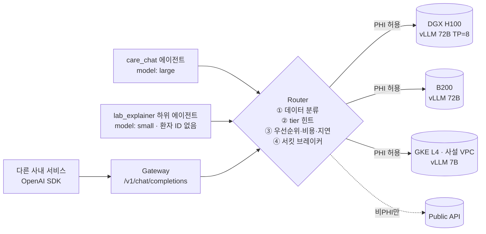

# LLM 서빙·라우팅 설계

## 구성



## 라우팅 정책 (`src/care_agent/serving/router.py`)

| 순서 | 규칙 | 이유 |
|---|---|---|
| 1 | 요청을 `phi` / `public`으로 분류: tool 결과가 있거나, 환자 범위 system prompt(`patient_id=`)거나, 주민번호·전화번호가 있거나, 이미지(검사결과지)면 `phi` | 환자 데이터가 신뢰 경계 밖으로 나가지 않게 하는 것이 최우선 |
| 2 | `phi`는 `phi_allowed: true` 백엔드만. **가용성 때문에 완화하지 않음** — 모두 다운이면 503 | 장애 시 public API로 폴백하는 것은 데이터 유출과 같음 |
| 3 | 헤더 `x-data-classification`은 **더 엄격하게만** 바꿀 수 있음 | 호출자의 실수로 PHI가 public으로 가는 경로 차단 |
| 4 | 에이전트 `model: small/large` → 같은 tier 백엔드 우선 | 간단한 설명은 작은 모델로, 상담은 큰 모델로 |
| 5 | `priority` → 비용 → 관측 지연(EWMA) 순 정렬 후 순차 시도 | 온프렘 우선, 그다음 저렴하고 빠른 곳 |
| 6 | 연속 실패 N회 → 서킷 open, `cooldown_s` 후 probe 1회(half-open) | 죽은 백엔드에 타임아웃을 계속 지불하지 않기 |

라우팅 결정(`backend`, `classification`, 시도 내역, 지연)은 모든 LLM 응답의 `meta.routing` → 에이전트 trace → Langfuse로 남습니다.

**설계상 중요한 결과**: `lab_explainer`는 환자 기록 도구가 없으므로 플랫폼이 환자 ID를 프롬프트에 넣지 않습니다(`{patient_id}`는 환자 범위 도구를 가진 에이전트에만 필수). 그래서 첫 호출은 `public`으로 분류되어 저렴한 외부 모델을 쓸 수 있고, 도구 결과가 붙은 이후 호출은 다시 `phi`로 분류됩니다(`tests/test_serving.py::test_platform_routes_by_agent_data`).

## 배포

| 대상 | 파일 | 메모 |
|---|---|---|
| 온프렘 DGX H100 / B200 | `deploy/vllm/docker-compose.yml` | `TP=8`로 72B 텐서 병렬. `--enable-prefix-caching`(긴 system prompt·도구 스키마 공유), `--enable-auto-tool-choice --tool-call-parser hermes`(에이전트 tool calling) |
| GKE L4 (사설 VPC) | `deploy/k8s/gke-vllm-qwen7b.yaml` | Internal LB, readiness `/health`, 모델 캐시 PVC, `/dev/shm` |
| 라우터 설정 | `deploy/router.example.yaml` | `phi_allowed`가 보안 경계 |

```bash
ROUTER_CONFIG=deploy/router.example.yaml uv run care-agent serve    # 에이전트가 라우터 사용
```

```bash
uv run care-agent gateway --config deploy/router.example.yaml       # 다른 서비스용 게이트웨이
```

## 벤치마크 방법 (`care-agent bench`)

```bash
uv run care-agent bench --base-url http://dgx-h100.internal:8000/v1 \
  --model Qwen/Qwen2.5-72B-Instruct --concurrency 1 8 32 64 --requests 64 --out bench/dgx-72b.json
```

- 스트리밍으로 측정: **TTFT**(체감 응답 시작), **ITL**(토큰 간 지연 = 읽는 속도), **E2E**, 동시성별 **req/s · output tok/s**
- 기본 프롬프트는 한국어 건강 상담 질문(출력 150~300 토큰) — 실제 트래픽 형태에 맞춤
- 같은 스크립트로 vLLM 직접 / 게이트웨이 경유 / 클라우드 API를 비교해 게이트웨이 오버헤드도 측정

> 이 저장소에는 GPU가 없어 **실측 결과를 싣지 않았습니다.** 표는 대상 하드웨어에서 위 명령으로 채웁니다. (`tests/test_serving.py`는 모의 SSE 스트림으로 측정 로직만 검증)

| 백엔드 | conc. | TTFT p50/p95 | ITL | out tok/s | 비고 |
|---|---|---|---|---|---|
| DGX H100 · 72B · TP8 | 1 / 32 / 64 | _측정 필요_ | | | |
| B200 · 72B | | _측정 필요_ | | | |
| GKE L4 · 7B | | _측정 필요_ | | | |

## 모델 도입 의사결정 프레임

새 모델(또는 "도입 vs 자체 개발")을 판단할 때 같은 순서로 증거를 모읍니다.

1. **품질 게이트** — `care-agent eval run`(에이전트 회귀 스위트 + LLM-as-a-Judge)과 `care-agent docs eval`(검사결과지 필드 정확도)을 후보 모델로 실행 → `eval compare`로 현행 대비 퇴행 케이스 확인. 안전 카테고리(emergency, injection, prescriptive) 퇴행이 하나라도 있으면 탈락.
2. **서빙 비용·지연** — `care-agent bench`로 목표 동시성에서 TTFT p95·tok/s 측정 → GPU 시간당 비용으로 1k 토큰당 원가 산출, public API 단가와 비교.
3. **데이터 경계** — PHI를 처리해야 하면 온프렘/사설 VPC에서 서빙 가능한 가중치 공개 모델만 후보. 외부 API는 비PHI 트래픽에 한정.
4. **운영 리스크** — 라이선스, tool-calling 파서 지원(vLLM), 컨텍스트 길이, 한국어 의료 용어 성능.
5. **자체 개발(파인튜닝) 판단 기준** — 1~4를 만족하는 공개 모델이 eval의 특정 실패 유형(예: `low_groundedness`, 검사명 매핑 실패)에서 일관되게 부족하고, 그 유형의 학습 데이터를 확보할 수 있을 때만.
